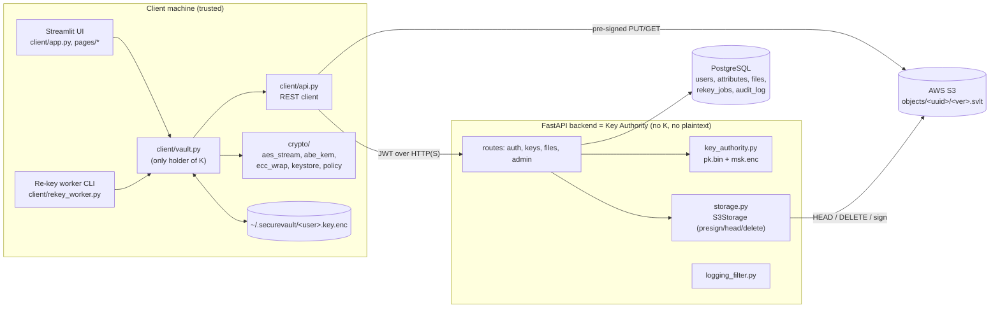
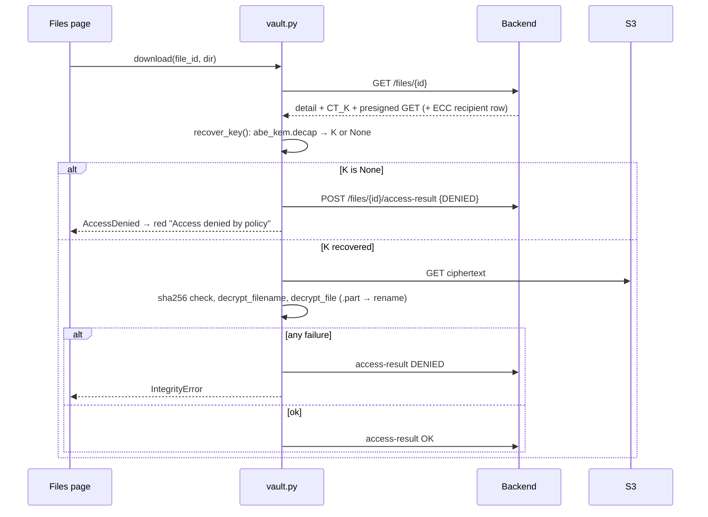
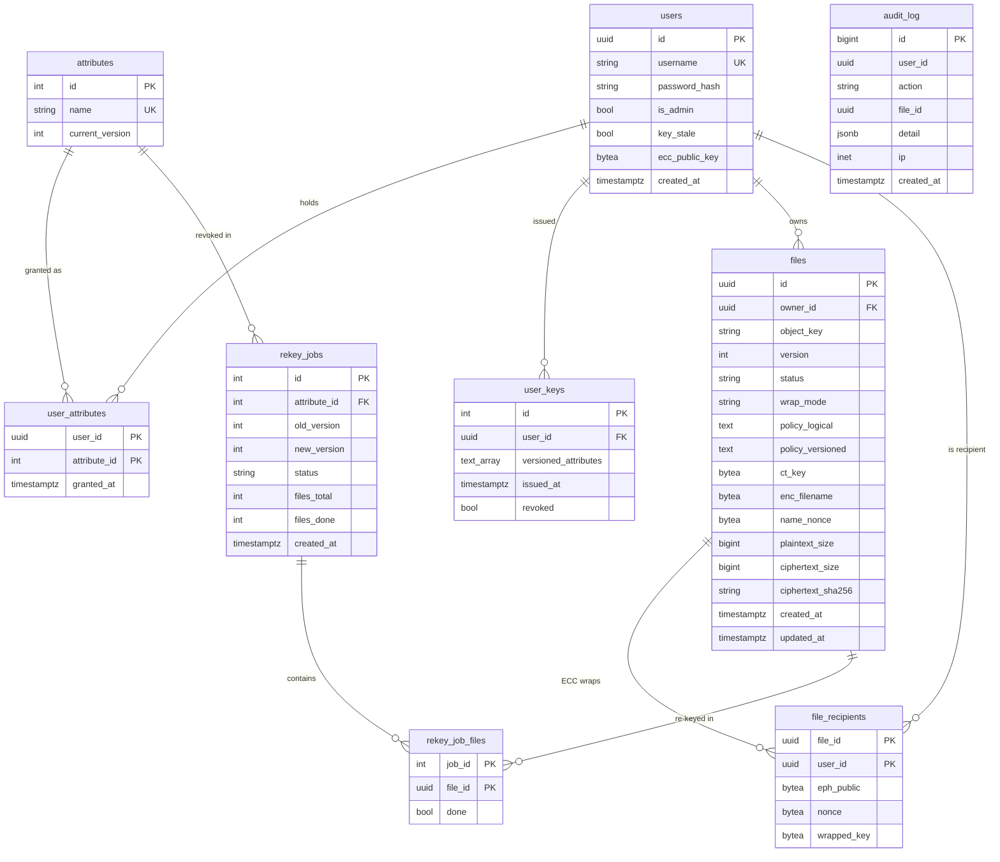

# SecureVault — Project Context

> Generated from a read of the repository at commit `5d3c456` (2026-10-20). Every claim cites the file it came from. Design intent lives in `documentation/01`–`08`; this document describes what the **code** actually does.

---

## 1. TL;DR

SecureVault is a zero-trust encrypted cloud file store built as an academic project. It shows how to keep files confidential even from the storage provider and the application server.
- **Client-side encryption.** Files are encrypted on the client with chunked AES-256-GCM (`crypto/aes_stream.py`).
- **Key sealing.** Each file's AES key is derived from a random group element. That element is sealed with CP-ABE (the BSW07 scheme) under an attribute policy such as `DEPT_CSE and ROLE_FACULTY` (`crypto/abe_kem.py`).
- **Storage.** Ciphertext goes to AWS S3 through pre-signed URLs. A FastAPI backend acts as Key Authority and metadata store, but never sees plaintext or file keys.
- **Audience.** It targets an organisation with role/department attributes; the seed data models a university CSE department (`backend/scripts/seed_demo.py:11-26`).
- **State.** All five build phases are implemented and tested: crypto core, backend, Streamlit client with the re-key worker, E1–E5 benchmarks, and the report (`CLAUDE.md`, `documentation/09_Report.md`).

## 2. Problem & Solution

**Problem.** Ordinary cloud storage trusts the provider and the app server with plaintext. Server-side access-control lists stop working the moment the database or bucket leaks. The report's threat model lists 12 adversaries (T1–T12, `documentation/09_Report.md:132-147`), from the cloud provider to a stolen laptop.

**Approach.**
1. **Encrypt before upload.** The client runs chunked AES-256-GCM. The header, file_id, chunk index and a final flag are bound into each chunk's AAD, so tampering, reordering, truncation and file swaps are all detected (`crypto/aes_stream.py:1-18, 60-61`).
2. **Enforce access cryptographically, not with ACLs.** CP-ABE is used as a KEM. `encap` draws a random `R ∈ GT`, sets `K = HKDF-SHA256(R, salt=file_id)` and stores only `CT = ABE.Encrypt(R, policy)` (`crypto/abe_kem.py:44-50`). Only a key whose attributes satisfy the policy recovers `R`.
3. **Make the server structurally blind.** The backend runs ABE `setup`/`keygen` as Key Authority. It never runs `encap`/`decap`; only the client calls those (`client/vault.py:141, 208, 289`).
4. **Revoke by versioning attributes.** Policies are encrypted under `ROLE_FACULTY_V<n>`. Revoking an attribute bumps `n`, and an admin-run client worker re-encrypts the affected files (`backend/app/routes/admin.py:115-182`, `client/vault.py:283-343`).

**Why this approach.**
- **Hybrid design.** ABE costs about 50–110 ms per operation (E2, `documentation/09_Report.md:211-220`). The hybrid pays that once per file on a 32-byte secret, while AES does the bulk work.
- **ABE vs per-recipient wrapping.** ABE metadata stays constant as the audience grows. ECC per-recipient wrapping grows linearly: 108 B per recipient against a fixed 1 776 B (E5, `09_Report.md:276-282`).

## 3. Feature List

| Feature | Status | Where in code |
|---|---|---|
| Chunked AES-256-GCM file format (SVLT v1) | Implemented | `crypto/aes_stream.py:88-134` |
| Encrypted filenames | Implemented | `crypto/aes_stream.py:137-149` |
| CP-ABE (BSW07/SS512) KEM | Implemented | `crypto/abe_kem.py:44-63` |
| ECC (X25519) per-recipient fallback wrap | Implemented | `crypto/ecc_wrap.py:33-54`, `client/vault.py:143-158` |
| Password-protected local keystore (scrypt + AES-GCM) | Implemented | `crypto/keystore.py:30-50`, `client/vault.py:38-60` |
| Policy validator + logical↔versioned rewrite | Implemented | `crypto/policy.py:32-119` |
| Key Authority (setup, MSK at rest, keygen) | Implemented | `backend/app/key_authority.py:36-48`, `backend/app/routes/keys.py:34-63` |
| JWT auth + bcrypt | Implemented | `backend/app/auth.py:20-58` |
| Stale-key guard (`409 KEY_STALE`) + automatic client re-issue | Implemented | `backend/app/auth.py:67-76`, `client/api.py:69-82`, `client/vault.py:78-94` |
| Pre-signed S3 upload/download (backend never proxies bytes) | Implemented | `backend/app/storage.py:23-57` |
| Upload size check (`HEAD` vs declared) | Implemented | `backend/app/routes/files.py:112-118` |
| File list / detail / delete | Implemented (delete is a soft delete in the DB, hard delete in S3) | `backend/app/routes/files.py:144-204` |
| Admin: create user, grant, revoke | Implemented | `backend/app/routes/admin.py:48-182` |
| Re-key jobs + worker (CLI and UI button) | Implemented (see §16 for edge-case bugs) | `backend/app/routes/admin.py:185-286`, `client/rekey_worker.py`, `client/pages/3_Admin.py:100-146` |
| Audit log | Implemented | `backend/app/audit.py`, `backend/app/routes/admin.py:289-302` |
| Login rate limiting (in-memory) | Implemented (single process only) | `backend/app/ratelimit.py`, `backend/app/routes/auth.py:29-38` |
| Secret-scrubbing log filter | Implemented | `backend/app/logging_filter.py` |
| `.env` placeholder rejection | Implemented | `backend/app/config.py:46-88` |
| Streamlit UI (login, upload, files, admin) | Implemented | `client/app.py`, `client/pages/*.py` |
| HTTPS for the demo (self-signed cert) | Implemented as a script; not wired into docker-compose | `scripts/gen_self_signed_cert.py` |
| Benchmarks E1–E5 with CSV + plots | Implemented | `benchmarks/bench.py` |
| Alembic migration | Present but unused by the documented flow (`seed_demo.py` and tests use `create_all`) | `backend/alembic/versions/0001_initial_schema.py` |
| SSE-S3 / bucket hardening | Lives outside the code (AWS console steps in doc 04); only *checked* by `s04_public_access_check.py` | `backend/scripts/s04_public_access_check.py` |
| Multi-authority ABE, proxy re-encryption, PQ wrapping, signed audit log | Planned (future work only) | `documentation/09_Report.md:346-361` |

## 4. Tech Stack

| Layer | Technology | Version (manifest) | Why it's used here |
|---|---|---|---|
| Language | Python | 3.8 (`abe-runtime/Dockerfile:1`) | Hard constraint from charm-crypto's native build |
| Pairing crypto | PBC library | 0.5.14 (built from source, `abe-runtime/Dockerfile`) | Native dependency of charm |
| ABE | charm-crypto (`CPabe_BSW07`, group `SS512`) | git HEAD of JHUISI/charm, unpinned | BSW07 CP-ABE implementation |
| Symmetric/ECC/KDF | `cryptography` | 41.0.7 | AES-GCM, HKDF, scrypt, X25519, TLS cert generation |
| API | FastAPI / uvicorn | 0.104.1 / 0.24.0.post1 | REST backend |
| Validation/config | pydantic / pydantic-settings | 2.5.3 / 2.1.0 | Schemas; `.env` loading with validators |
| ORM / migrations | SQLAlchemy / Alembic | 2.0.23 / 1.12.1 | Postgres models; one migration |
| DB driver | psycopg2-binary | 2.9.9 | Postgres |
| Database | PostgreSQL | 15 (`docker-compose.yml`) | Metadata, users, audit (uses `UUID`, `BYTEA`, `INET`, `JSONB`, `ARRAY`) |
| Auth | python-jose, passlib, bcrypt | 3.3.0, 1.7.4, 3.2.2 | HS256 JWT; bcrypt pinned <4 for passlib's self-test |
| Object storage | boto3 / botocore | 1.33.13 | S3 pre-signed URLs, HEAD, DELETE |
| Client UI | Streamlit | 1.37.1 | Last release supporting Python 3.8 |
| HTTP client | requests | 2.31.0 | Client → API and → S3 |
| Benchmarks | matplotlib | 3.7.5 | Plots |
| Tests | pytest, pytest-cov, httpx, moto[s3] | 7.4.4, 4.1.0, 0.24.1, 5.0.28 | moto 5 for `mock_aws` |
| Containers | Docker / docker-compose | — | `db`, `backend`, `client` services |

## 5. Architecture

Three trust zones:
- **The client is trusted.** It holds the ABE secret key, file keys and plaintext.
- **The backend is honest-but-curious and acts as Key Authority.** It holds the MSK, metadata and `CT_K`.
- **S3 is untrusted.** It holds ciphertext only.

The `crypto/` package is imported by both the client and the backend. The backend only uses `setup`, `keygen`, (de)serialisation and the keystore (`backend/app/key_authority.py`, `backend/app/routes/keys.py`). The bulk bytes travel client↔S3 directly over pre-signed URLs, so the backend never proxies file content.



## 6. Directory Structure

```
securevault/
├── CLAUDE.md                     # contributor rules: doc 08 global rules, invariants, commands
├── README.md                     # operator view: quick start, demo users, security notes
├── requirements.txt              # single pinned manifest for backend, client, benchmarks, tests
├── docker-compose.yml            # postgres:15 + backend (:8000) + client (:8501), both on abe-runtime
├── abe-runtime/Dockerfile        # python:3.8-slim-bullseye + PBC 0.5.14 + charm-crypto from source
├── .streamlit/config.toml        # Streamlit light theme, usage stats off
├── crypto/                       # shared crypto package (client + backend)
│   ├── aes_stream.py             # SVLT chunked AES-GCM format, filename encryption, size prediction
│   ├── abe_kem.py                # BSW07 setup/keygen/encap/decap + (de)serialisers
│   ├── ecc_wrap.py               # X25519 + HKDF + AES-GCM per-recipient key wrap
│   ├── keystore.py               # SVKS blob: scrypt(2^15,8,1) + AES-GCM
│   ├── policy.py                 # tokenizer/validator, to_versioned, to_logical
│   └── tests/                    # C-01..C-12 + extras
├── backend/
│   ├── .env.example              # env template (backend/.env is gitignored; present locally, not read)
│   ├── alembic.ini, alembic/     # env.py + 0001_initial_schema.py
│   ├── app/
│   │   ├── main.py               # FastAPI app, router mounting, startup checks, /health
│   │   ├── config.py             # pydantic Settings + placeholder/TTL validators
│   │   ├── db.py                 # lazy engine + sessionmaker, get_db dependency
│   │   ├── models.py             # 9 ORM tables (doc 05 §1)
│   │   ├── schemas.py            # pydantic request/response models
│   │   ├── auth.py               # bcrypt, JWT, get_current_user / require_admin / require_fresh_*
│   │   ├── key_authority.py      # load pk.bin + msk.enc; issue_key; setup_and_save
│   │   ├── storage.py            # Storage Protocol + S3Storage
│   │   ├── audit.py              # audit_log writer (INET-safe ip)
│   │   ├── ratelimit.py          # in-memory per-(user, IP) login throttle
│   │   ├── logging_filter.py     # SecretScrubFilter
│   │   ├── codec.py              # base64 helpers
│   │   └── routes/{auth,keys,files,admin}.py
│   ├── scripts/
│   │   ├── init_ka.py            # ABE setup() → backend/pk.bin, backend/msk.enc
│   │   ├── seed_demo.py          # create_all + 11 attributes + 5 demo users
│   │   ├── e2e.py                # full round trip against REAL S3
│   │   └── s04_public_access_check.py  # S-04 bucket-privacy check against REAL S3
│   ├── tests/                    # B-01..B-07, S-01..S-03, S-05, logging filter; moto + Postgres
│   ├── pk.bin, msk.enc           # generated KA material (gitignored; binary, not read)
├── client/
│   ├── app.py                    # Streamlit entry: login form + dashboard
│   ├── ui.py                     # shared sidebar, CSS, session helpers, key re-fetch
│   ├── api.py                    # SecureVaultApi, ApiError/KeyStaleError, one-shot stale retry
│   ├── vault.py                  # Vault: upload/download/rekey_file, keystore, login()
│   ├── rekey_worker.py           # admin CLI: --list / --job N / --all
│   └── pages/1_Upload.py, 2_Files.py, 3_Admin.py
├── benchmarks/
│   ├── bench.py                  # E1–E5 harness → results.csv + plots/*.png
│   ├── results.csv, plots/*.png  # local outputs (gitignored, not tracked)
├── scripts/
│   ├── abe_smoke.py              # Phase 0 BSW07 proof
│   └── gen_self_signed_cert.py   # certs/server.{key,crt} for local HTTPS
├── .securevault/*.key.enc        # local demo keystores (gitignored; binary, not read)
└── documentation/01..09 + README # design specs (01–08) and report (09)
```

There is no CI config, Makefile or `pyproject.toml`.

## 7. Core Flows

### 7.1 Login and key acquisition
1. The UI calls `vault.login()` (`client/app.py:66-69`). It sends `POST /auth/login` (`client/vault.py:383`).
2. The backend checks the rate limiter, then verifies the password with bcrypt. It audits `LOGIN` or `LOGIN_FAILED` and returns a JWT plus `key_stale` (`backend/app/routes/auth.py:24-59`).
3. The client calls `GET /auth/me` and `GET /keys/public-params` (unauthenticated) and deserialises `pk` (`client/vault.py:384-385`).
4. **If the key is not stale and a keystore exists:** the client unlocks `~/.securevault/<user>.key.enc` locally (`client/vault.py:387-399`).
5. **Otherwise:** the client sends `POST /keys/issue`. The backend builds versioned attribute names, using all versions 1..n for admins (`backend/app/routes/keys.py:45-53`). It decrypts `msk.enc`, runs `keygen`, records `user_keys`, clears `key_stale` and audits `KEY_ISSUE` (`keys.py:55-61`).
6. The client keeps or creates an X25519 keypair and registers the public half with `PUT /keys/ecc`. It then writes the keystore (`client/vault.py:404-412`).
7. The client installs `vault.refresh_key` as the `409 KEY_STALE` handler (`client/vault.py:417`).

### 7.2 Upload (ABE mode)

```mermaid
sequenceDiagram
  participant U as Upload page
  participant V as vault.py
  participant B as Backend
  participant S as S3
  U->>V: upload(path, name, logical_policy)
  V->>B: GET /attributes
  V->>V: policy.to_versioned()  →  e.g. DEPT_CSE_V1 and ROLE_FACULTY_V2
  V->>V: ciphertext_size_for(plaintext_size)
  V->>B: POST /files/init {ciphertext_size, wrap_mode}
  B-->>V: file_id, object_key, presigned PUT url  (row status=pending)
  V->>V: abe_kem.encap(pk, versioned, file_id) → K, CT_K
  V->>V: aes_stream.encrypt_file(K, file_id); encrypt_filename; sha256
  V->>S: PUT ciphertext (pre-signed)
  V->>B: POST /files/{id}/complete {policies, CT_K, enc_filename, sha256,…}
  B->>S: HEAD object (size must match)
  B-->>V: FileDetail (status=active), audit UPLOAD
```
Code: `client/pages/1_Upload.py:100-114` → `client/vault.py:117-194` → `backend/app/routes/files.py:59-141`.

`/files/init` must come first because both the HKDF salt and the chunk AAD are bound to the server's `file_id` (`client/vault.py:121-123`). The ciphertext size is predicted, and the prediction is asserted against the real size after encryption (`client/vault.py:167-169`). The temp ciphertext is deleted in `finally` (`client/vault.py:178-180`).

**ECC mode** replaces step "encap": `K = os.urandom(32)`, and `ecc_wrap.wrap_key` runs once per chosen recipient (`client/vault.py:143-158`). Recipients come from `GET /keys/ecc/recipients` (`client/pages/1_Upload.py:64-76`).

### 7.3 Download and access decision


Code: `client/pages/2_Files.py:73-107`, `client/vault.py:198-273`, `backend/app/routes/files.py:164-185, 207-217`.

The access decision is cryptographic. The server returns `CT_K` and a download URL to **any** authenticated, non-stale user (`files.py:164-185`); only the user's key decides whether decryption succeeds.

### 7.4 Revocation
1. The admin clicks Revoke (`client/pages/3_Admin.py:59-75`), which calls `DELETE /admin/users/{id}/attributes/{name}`.
2. The backend deletes the `user_attributes` link and bumps `attributes.current_version` (`backend/app/routes/admin.py:141-147`).
3. It marks every **remaining** holder `key_stale=True`. The admin is among them, since the admin holds every attribute (`admin.py:149-156`).
4. It selects active files whose `policy_versioned LIKE '%<NAME>_V<old>%'` and creates a `rekey_jobs` row. It adds a `rekey_job_files` row per affected file and sets each file to `status='rekeying'` (`admin.py:158-176`).
5. It audits `REVOKE` and returns `{job_id, files_total}`.
6. Remaining holders' next guarded call returns `409 KEY_STALE`. `client/api.py:69-82` calls `refresh_key()` once, then retries.

### 7.5 Re-key (admin worker)
1. Entry points are `python -m client.rekey_worker --job N` (`client/rekey_worker.py:65-124`) or the UI's "Run re-key now" button (`3_Admin.py:123-145`).
2. The worker calls `GET /admin/rekey-jobs/{id}/files`, which returns pending files with `CT_K`, encrypted name and a pre-signed GET (`admin.py:194-219`).
3. Per file, `vault.rekey_file` (`client/vault.py:283-343`) does the following:
   1. `decap` with the admin's all-versions key.
   2. `to_logical` → `to_versioned` with fresh versions.
   3. A new `encap` (new `R` and `K`, same `file_id`).
   4. Download, decrypt, re-encrypt, and re-encrypt the filename.
   5. `POST …/init` gets a pre-signed PUT for `objects/<id>/<version+1>.svlt`.
   6. PUT the new object, then `POST …/commit`.
4. On commit, the backend HEADs the new object and checks its size. It updates the file row (version+1, new policy, `CT_K`, hash, status active) and deletes the old S3 object. It marks the job file done, increments `files_done`, marks the job `done` when complete, and audits `REKEY` (`admin.py:240-286`).

### 7.6 Delete
`DELETE /files/{id}` is allowed for the owner or an admin. It deletes the S3 object, sets `status='deleted'` (the row is kept) and audits `DELETE` (`backend/app/routes/files.py:188-204`).

## 8. Module Deep-Dives

### 8.1 `crypto/` — shared primitives
Dependencies: `cryptography`, plus `charm` for `abe_kem` only. Nothing in this package imports backend or client code.

| Function | Signature | What it does |
|---|---|---|
| `aes_stream.encrypt_file` | `(in_path, out_path, key, file_id, chunk_size=65536) -> None` | Writes a 32-byte header, then `AESGCM.encrypt(nonce_prefix‖idx, chunk, header‖file_id‖idx‖final)` per chunk (`:88-104`). An empty file still gets 1 chunk. |
| `aes_stream.decrypt_file` | `(in_path, out_path, key, file_id) -> None` | Parses the header, checks per-chunk length, raises on trailing data, writes to `.part` and renames only on success (`:108-134`). |
| `aes_stream.ciphertext_size_for` | `(plaintext_size, chunk_size) -> int` | `32 + n + 16·chunks` (`:78-85`). |
| `aes_stream.encrypt_filename / decrypt_filename` | `(name, key, file_id) -> (enc, nonce)` | AES-GCM with AAD `file_id‖b"name"` (`:137-149`). |
| `abe_kem.setup / keygen` | `() -> (pk, msk)`; `(pk, msk, attrs) -> sk` | BSW07 on `SS512` (`:29-36`). |
| `abe_kem.encap` | `(pk, versioned_policy, file_id) -> (K, ct_bytes)` | `R←GT`, `K=HKDF-SHA256(R, salt=file_id, info="securevault-file-key-v1")` (`:44-50`). |
| `abe_kem.decap` | `(pk, sk, ct_bytes, file_id) -> Optional[K]` | Returns `None` on `False`, on `None`, or on any exception (`:53-63`) — global rule 6. |
| `ecc_wrap.wrap_key` | `(K, recipient_pub, file_id, recipient_id) -> (eph_pub, nonce, wrapped)` | Ephemeral X25519 ECDH → HKDF(salt=file_id) → AES-GCM with AAD `file_id‖recipient_id` (`:33-42`). |
| `ecc_wrap.unwrap_key` | `(...) -> Optional[bytes]` | Returns `None` on any failure (`:45-54`). |
| `keystore.encrypt_blob / decrypt_blob / save / load` | password-based | `SVKS‖0x01‖salt16‖nonce12‖ct`; header used as AAD (`:30-61`). Used for user keystores and `msk.enc`. |
| `policy.validate` | `(policy, known) -> tokens` | Single-pass grammar check: operands/operators alternate, parentheses balance, attribute names match `^[A-Z][A-Z0-9_]*$`, every name must be known (`:32-69`). |
| `policy.to_versioned / to_logical` | str → str | Appends or strips `_V<n>` (`:72-119`). |

### 8.2 `backend/app/` — API and Key Authority
- **`main.py`** mounts the four routers under `/api/v1`. On startup it loads settings, which raises on placeholder secrets, installs the log scrubber with the four secret values as literals, and prints warnings (`:27-44`). `GET /api/v1/health` returns `{"status":"ok"}` (`:47-50`).
- **`config.py`** — `Settings` reads `backend/.env` (`:28`). Validators:
  - secrets must not be placeholders and must be at least 32 characters, unless `SECUREVAULT_DEV` is set (`:46-58`)
  - `STORAGE_BACKEND` ∈ {s3, moto}
  - `S3_PREFIX` ends with `/`
  - `30 ≤ PRESIGN_TTL_SECONDS ≤ 3600` (`:69-88`)

  `get_settings()` is `lru_cache`d.
- **`auth.py`** — bcrypt via passlib, HS256 JWT with `sub`/`iat`/`exp` (`:28-36`). Dependencies:
  - `get_current_user` returns 401 on a missing, invalid or expired token or an unknown user
  - `require_admin` returns 403
  - `require_fresh_key` and `require_fresh_admin` return 409 `KEY_STALE` (`:43-76`)
- **`key_authority.py`** — `load()` reads `backend/pk.bin` and decrypts `backend/msk.enc` with `KA_PASSPHRASE` on **every call** (`:44-48`). `setup_and_save()` writes both files (`:36-41`).
- **`storage.py`** — `Storage` Protocol with `presign_put`, `presign_get`, `head` and `delete`. `S3Storage` uses SigV4 and the configured TTL. `get_storage()` returns `S3Storage` for both `s3` and `moto`; in tests, moto's `mock_aws` intercepts boto3 (`:16-64`).
- **`audit.py`** — inserts an `AuditLog` row and normalises `ip` to a valid INET or `NULL` (`:10-28`).
- **`ratelimit.py`** — a dict of `(username.lower(), ip) → [monotonic timestamps]` behind a lock; `check` returns the seconds to wait (`:26-48`).
- **`logging_filter.py`** — regexes redact SigV4 params, Bearer/JWTs, JSON key fields, and base64 runs ≥40 / hex runs ≥40 (`:25-40`). The filter is attached to root and uvicorn/fastapi/sqlalchemy **handlers** (`:77-94`).
- **`routes/*`** — see §9.

### 8.3 `client/`
- **`api.py`** — `SecureVaultApi` wraps `requests.Session`. `_raise_for_status` maps `{"detail":{"error":{code,message}}}` to `ApiError`, or `KeyStaleError` for 409 `KEY_STALE` (`:30-46`). `_request` retries **once** after the stale handler succeeds, with a re-entrancy guard (`:69-82`). Its S3 helpers stream PUT/GET with a 300 s timeout (`:185-205`).
- **`vault.py`** — `Vault` holds `api`, `user`, `pk`, `sk`, versioned attributes and the ECC private key. It is the only place `K` exists:
  - upload, download, re-key: §7
  - `login()`: `:376-418`
  - `safe_name()` strips path components from decrypted filenames (`:368-373`)
  - `shred()` only unlinks; it does not overwrite (`:359-365`)
- **`ui.py`** — shared sidebar showing identity, attribute pills, versioned key contents, "Re-fetch ABE key" and Sign out. It also holds CSS and the `require_vault` page guard.
- **`pages/1_Upload.py`** — a policy builder where rows are ORed and attributes within a row are ANDed (`:49-61`), plus an ABE/ECC toggle and recipient picker. It stages the uploaded bytes to `~/.securevault/tmp` and shreds them afterwards.
- **`pages/2_Files.py`** — table of all files; Download/Delete; distinct AccessDenied and IntegrityError messages. Rows with `status == "rekeying"` hide the Download button.
- **`pages/3_Admin.py`** — tabs for Users & attributes (grant/revoke/create), Re-key jobs (progress + run) and Audit log.
- **`rekey_worker.py`** — CLI with `--job`, `--all`, `--list`, `--api`, `--username`, `--insecure` and `--quiet`. It reads the password from `SECUREVAULT_ADMIN_PASSWORD` or prompts for it.

### 8.4 `benchmarks/bench.py`
E1 (AES vs size), E2 (ABE encap/decap vs policy size), E3 (keygen vs attributes), E4 (hybrid round trip), E5 (ECC vs ABE per recipient count). Flags: `--only`, `--reps` (default 10), `--max-mb` (default 100), `--no-abe` (`:284-300`). Output goes to `benchmarks/results.csv` (107 data rows locally) and `benchmarks/plots/*.png`.

## 9. API Reference

All routes are prefixed with `/api/v1`. Binary fields are base64 in JSON (`backend/app/codec.py`). Errors are returned as `{"detail":{"error":{"code","message"}}}`.

Auth levels used below:
- **JWT** — any valid token (`get_current_user`)
- **Fresh** — JWT and `key_stale=false`
- **Admin-fresh** — admin and not stale

| Method | Path | Purpose | Request | Response | Auth |
|---|---|---|---|---|---|
| GET | `/health` | Liveness | — | `{status}` | none |
| POST | `/auth/login` | Login; rate-limited (429 + `Retry-After`) | `{username,password}` | `{access_token, expires_in, key_stale, is_admin}` | none |
| GET | `/auth/me` | Current identity | — | `{id, username, attributes[], is_admin, key_stale}` | JWT |
| GET | `/keys/public-params` | ABE PK | — | `{pk, group:"SS512", scheme:"BSW07"}` | **none** |
| POST | `/keys/issue` | Issue ABE SK; clears stale flag | — | `{sk, versioned_attributes[]}` | JWT |
| PUT | `/keys/ecc` | Register X25519 public key | `{public_key}` | `{status}` | JWT |
| GET | `/keys/ecc/recipients` | Directory of users with ECC keys (added beyond doc 05's endpoint table) | — | `[{user_id, username, public_key}]` | JWT |
| GET | `/attributes` | Attribute universe + current versions | — | `[{name, current_version}]` | JWT |
| POST | `/files/init` | Create pending row + presigned PUT | `{ciphertext_size, wrap_mode: ABE\|ECC}` | `{file_id, object_key, upload_url, expires_in}` | Fresh |
| POST | `/files/{id}/complete` | Commit metadata after HEAD size check (422 `SIZE_MISMATCH`); owner only | `{policy_logical, policy_versioned, ct_key?, enc_filename, name_nonce, plaintext_size, ciphertext_sha256, recipients?[]}` | `FileDetail` (201) | Fresh |
| GET | `/files?mine=bool` | List non-deleted files | — | `[FileSummary]` | Fresh |
| GET | `/files/{id}` | Detail + presigned GET (+ caller's ECC recipient row) | — | `FileDetail` | Fresh |
| DELETE | `/files/{id}` | Delete S3 object, soft-delete row | — | 204 | Fresh, owner or admin |
| POST | `/files/{id}/access-result` | Audit `DOWNLOAD_OK`/`DOWNLOAD_DENIED` | `{result}` | `{status}` | Fresh |
| POST | `/admin/users` | Create user (auto-creates unknown attributes) | `{username, password, attributes[], is_admin}` | `AdminUserResponse` (201) | Admin-fresh |
| GET | `/admin/users` | List users + attributes | — | `[AdminUserResponse]` | Admin-fresh |
| POST | `/admin/users/{id}/attributes` | Grant; marks user stale | `{attribute}` | `{status}` (201) | Admin-fresh |
| DELETE | `/admin/users/{id}/attributes/{name}` | Revoke → version bump + rekey job | — | `{job_id, files_total}` | Admin-fresh |
| GET | `/admin/rekey-jobs` | List jobs | — | `[RekeyJobResponse]` | Admin-fresh |
| GET | `/admin/rekey-jobs/{job}/files` | Pending files with CT_K, encrypted name, presigned GET (`enc_filename`/`name_nonce` added beyond doc 05) | — | `[RekeyFileItem]` | Admin-fresh |
| POST | `/admin/rekey-jobs/{job}/files/{fid}/init` | Presigned PUT for version+1 | — | `{object_key, upload_url, expires_in}` | Admin-fresh |
| POST | `/admin/rekey-jobs/{job}/files/{fid}/commit` | Swap object + metadata | `{policy_versioned, ct_key, enc_filename, name_nonce, ciphertext_sha256, ciphertext_size}` | `{status}` | Admin-fresh |
| GET | `/admin/audit?limit&action` | Audit log, newest first | — | `[AuditLogItem]` | Admin-fresh |

## 10. Data Model

The tables are defined in `backend/app/models.py` and in Alembic `0001_initial_schema.py`. The audit log has one index, on `audit_log.created_at DESC` (`models.py:112`).



- **`files.status` values:** `pending`, `active`, `rekeying`, `deleted`.
- **`rekey_jobs.status` values:** `queued`, `done`. Nothing in the code ever sets `running`, although `rekey_worker --all` filters on `status != "done"`.
- **`audit_log.action` values written by code:** `LOGIN`, `LOGIN_FAILED`, `KEY_ISSUE`, `UPLOAD`, `DOWNLOAD_OK`, `DOWNLOAD_DENIED`, `DELETE`, `USER_CREATE`, `GRANT`, `REVOKE`, `REKEY`.
- **Unused columns:**
  - `user_keys.revoked` is never set to true anywhere.
  - `files.updated_at` has only a server default and is never updated on change.
- **Object keys** are `<S3_PREFIX><file_uuid>/<version>.svlt`.

## 11. AI/ML Details

Omitted: there is no AI/ML component in the repository.

## 12. Configuration & Environment

| Name | Required? | Used in | Purpose |
|---|---|---|---|
| `DATABASE_URL` | Yes | `backend/app/config.py:30`, `db.py:16`, `alembic/env.py` | SQLAlchemy URL |
| `JWT_SECRET` | Yes (≥32 chars, non-placeholder outside dev) | `config.py:31`, `auth.py:36,51` | HS256 signing key |
| `JWT_TTL_MINUTES` | No (30) | `config.py:32`, `auth.py:34` | Token lifetime; warns if >60 |
| `KA_PASSPHRASE` | Yes (≥32 chars outside dev) | `config.py:33`, `key_authority.py:41,47` | Encrypts `msk.enc` |
| `STORAGE_BACKEND` | No (`s3`) | `config.py:34`, `storage.py:62` | `s3` or `moto` (both use `S3Storage`) |
| `AWS_REGION` | No (`ap-south-1`) | `config.py:35`, `storage.py:64` | S3 region |
| `S3_BUCKET` | Yes | `config.py:36` | Bucket name |
| `S3_PREFIX` | No (`objects/`) | `config.py:37`, `routes/files.py:29`, `routes/admin.py:234` | Object key prefix; must end with `/` |
| `AWS_ACCESS_KEY_ID` / `AWS_SECRET_ACCESS_KEY` | Yes (non-placeholder outside dev) | `config.py:38-39`; read by boto3 from the process env | AWS credentials. `Settings` only validates them; `boto3.client` gets credentials from the environment or the default chain, not from `Settings`. docker-compose injects them through `env_file`. |
| `PRESIGN_TTL_SECONDS` | No (300; 30–3600) | `config.py:40`, `storage.py` | Pre-signed URL lifetime |
| `LOGIN_MAX_ATTEMPTS` | No (5) | `config.py:43`, `routes/auth.py:30` | Throttle threshold (not in `.env.example`) |
| `LOGIN_WINDOW_SECONDS` | No (60) | `config.py:44` | Throttle window (not in `.env.example`) |
| `SECUREVAULT_DEV` | No | `config.py:23-24`; set by `backend/tests/conftest.py:11` | Relaxes placeholder checks |
| `AWS_SESSION_TOKEN` | Tests only | `backend/tests/conftest.py:20` | moto dummy |
| `SECUREVAULT_API` | No (`http://localhost:8000/api/v1`) | `client/api.py:12`, `backend/scripts/e2e.py:25`, `docker-compose.yml` | Client → API base URL |
| `SECUREVAULT_HOME` | No (`~/.securevault`) | `client/vault.py:19`, `docker-compose.yml` | Keystore + temp dir |
| `SECUREVAULT_ADMIN` / `SECUREVAULT_ADMIN_PASSWORD` | No | `client/rekey_worker.py:71,79` | Worker credentials |
| `SECUREVAULT_E2E_USER` / `SECUREVAULT_E2E_PASSWORD` | No (`prof_a`/`prof-a-pass`) | `backend/scripts/e2e.py:26-27` | e2e identity |
| `.streamlit/config.toml` | — | Streamlit | Theme, `gatherUsageStats=false` |
| `backend/alembic.ini` | — | Alembic | URL overridden from settings in `alembic/env.py` |

## 13. Setup & Run

From `README.md` and `CLAUDE.md`:

```bash
cp backend/.env.example backend/.env
python -c "import secrets; print(secrets.token_hex(32))"   # paste into JWT_SECRET and KA_PASSPHRASE

docker-compose up --build                                   # db :5432, backend :8000, client :8501
docker-compose exec backend python backend/scripts/init_ka.py     # pk.bin + msk.enc
docker-compose exec backend python backend/scripts/seed_demo.py   # tables (create_all) + demo users
# open http://localhost:8501
```

The schema is created by `seed_demo.py` through `Base.metadata.create_all` (`backend/scripts/seed_demo.py:30-31`). `alembic upgrade head` is not part of any documented step; it should be equivalent, but I inferred that and did not verify it.

Tests must run inside the abe-runtime image, and need a reachable Postgres. The conftest default DB is `securevault_test` on `localhost`. It **drops every table** at session end and regenerates `pk.bin`/`msk.enc` (`backend/tests/conftest.py:12, 334-344`).
```bash
pytest crypto/ --cov=crypto
DATABASE_URL=postgresql+psycopg2://sv:sv@<host>:5432/securevault_test pytest backend/ --cov=backend
```
The test database must already exist; this is inferred, since `create_all` creates tables but not the database.

Real AWS (the only scripts allowed to touch it):
```bash
python backend/scripts/e2e.py
python backend/scripts/s04_public_access_check.py
```

Client and worker:
```bash
streamlit run client/app.py
python -m client.rekey_worker --list | --job 3 | --all [--insecure]
```

Benchmarks, HTTPS and the ABE smoke test:
```bash
python benchmarks/bench.py [--only E1,E5 --no-abe --reps 10 --max-mb 100]

python scripts/gen_self_signed_cert.py
uvicorn backend.app.main:app --host 0.0.0.0 --port 8443 --ssl-keyfile certs/server.key --ssl-certfile certs/server.crt

python scripts/abe_smoke.py
```

Deployment beyond docker-compose (cloud hosting, reverse proxy): **Not determinable from repo.**

## 14. Testing

| Suite | Tests | What they prove |
|---|---|---|
| `crypto/tests/test_aes_stream.py` | C-01 round trip (parametrised sizes), C-02 byte tamper with no partial output, C-03 chunk swap, C-04 dropped final chunk, C-05 wrong file_id, filename round-trip and wrong-id cases, size prediction | File format integrity |
| `crypto/tests/test_abe_kem.py` | C-06 satisfying key, C-07 non-satisfying → `None`, C-08 collusion, C-09 old-version key denied, malformed CT → `None`, serialisation | KEM correctness and denial semantics |
| `crypto/tests/test_keystore.py` | round trip, C-10 wrong password, corrupted blob | Keystore |
| `crypto/tests/test_policy.py` | C-11 unknown attribute, injection, lowercase, unbalanced parentheses, dangling operator; versioned/logical round trip | Policy grammar |
| `crypto/tests/test_ecc_wrap.py` | C-12 wrap/unwrap, non-recipient | ECC fallback |
| `backend/tests/test_auth.py` | B-01 login/wrong password/expired JWT, rate limit, `LOGIN_FAILED` audit, INET normalisation | Auth |
| `backend/tests/test_admin.py` | B-02 non-admin → 403 | Authorisation |
| `backend/tests/test_files.py` | B-03 presign TTL, B-04 size mismatch 422, B-06 delete removes the object | Storage contract on moto |
| `backend/tests/test_revoke.py` | B-05 version bump + stale + job files; admin key covers old version | Revocation |
| `backend/tests/test_audit.py` | B-07 audit rows for core actions | Audit |
| `backend/tests/test_security.py` | S-01 no plaintext/K in DB or logs, S-02 S3 object high-entropy, S-03 object key has no filename, S-05 revoked user denied after re-key | Leakage |
| `backend/tests/test_logging_filter.py` | 8 scrubber tests | Log redaction |

Outside pytest, S-04 (`s04_public_access_check.py`) and the e2e script run against real AWS.

**Gaps:**
- No tests for `client/` at all: the UI, the `api.py` stale-retry logic, or `vault.login` keystore branches. The re-key worker is only exercised indirectly by S-05 (`test_security.py:193`).
- No tests for ECC-mode files under revocation (see §16 bug 1), for re-key commit idempotency, or for zero-file revoke jobs.
- No test for the `rekeying`-status download path or for `pending` rows abandoned before commit.
- No CI runs any of this.
- Coverage numbers: a `.coverage` file exists locally (binary, not read), so the figures are **Not determinable from repo**.

## 15. Project History & Team

Git log: 22 commits, 2026-10-15 → 2026-10-20.

| Date | Author | Work |
|---|---|---|
| 2026-10-15 | KAAARTHIKK | Specs and CLAUDE.md; scaffold; Dockerfile (PBC + charm); compose; Phase 0 ABE smoke test; crypto core + C-01..C-12; MSK serialisation; bcrypt pin; models, schemas, Alembic; auth/KA/storage/audit; routes; scripts; B-01..B-07 |
| 2026-10-15 | darunnnnnn | One large commit `cb89cec` "complete phases 3-5", touching 36 files and +3 243 lines. It covers the whole `client/` package, `benchmarks/bench.py`, hardening (`logging_filter`, `ratelimit`, config validators), `test_security.py`, `test_logging_filter.py`, README, the report, and the cert script. |
| 2026-10-19 | KAAARTHIKK | INET-safe audit IPs and the moto 5 pin; merge of phases 3-5; **the admin key holds every attribute version** (fixes re-key after revoke); report benchmark tables filled |
| 2026-10-20 | KAAARTHIKK | Client credential trimming, sign-in error surfacing, UI theme |

`git shortlog`: KAAARTHIKK 21 commits, darunnnnnn 1. CLAUDE.md mentions Claude Code and doc 08 is a "Claude Code Build Prompt", which suggests AI-assisted implementation. Each person's individual role beyond commit authorship is **Not determinable from repo**.

## 16. Known Issues, TODOs & Tech Debt

There are no `TODO`, `FIXME`, `HACK` or `XXX` comments in any `.py` file. The issues below come from reading the code.

**Correctness bugs**
1. **ECC files get stuck in `rekeying`.**
   - Cause: ECC uploads still store `policy_versioned` (`client/vault.py:184`), and the revoke query does not filter on `wrap_mode` (`backend/app/routes/admin.py:158-163`). So an ECC file whose policy mentions the revoked attribute is queued.
   - Effect: `rekey_file` raises `AccessDenied` because `ct_key` is None (`client/vault.py:288-291`). The file stays `rekeying` and hidden from Download in the UI (`2_Files.py:69-71`), and the job never reaches `done`.
2. **The revoke matcher uses a substring `LIKE`.** `'%ROLE_FACULTY_V1%'` also matches `ROLE_FACULTY_V10`…`V19` (`admin.py:161`). Over-matching only causes extra re-keys today, but it is still wrong.
3. **Zero-file revoke jobs stay `queued` forever.** `status='done'` is only set inside commit (`admin.py:281-282`). They show up in `rekey_worker --all`, though it handles them harmlessly ("no pending files").
4. **Re-key init/commit don't check that the file belongs to the job.** They also don't check whether that job file is already `done`. A repeated commit increments `files_done` again, bumps `version` again, and HEADs a key that doesn't exist (`admin.py:222-286`).
5. **The old object is deleted before the DB commit.** In re-key commit, `storage.delete(old_object_key)` runs before `db.commit()` (`admin.py:271, 285`). If the commit fails, the row still points at a deleted object.
6. **Deleting a file mid-job breaks the job.** `list_rekey_job_files` doesn't filter `files.status`, so the worker tries to download a deleted object and fails (`admin.py:205-210`).
7. **The UI's "Files visible" count includes `pending` and `rekeying` rows**, which can't be downloaded normally. `list_files` excludes only `deleted` (`files.py:150`).

**Security and robustness**
- **The server doesn't enforce `rekeying` status.** `GET /files/{id}` serves `rekeying` files, so only the UI hides the button. During the re-key window a revoked user can still fetch and decrypt the old object. This is the documented limitation L2 (`09_Report.md:326-328`).
- **`access-result` is not validated.** It accepts any `file_id` (no existence check) and any `result` string; everything other than `"OK"` is logged as denied (`files.py:207-217`).
- **Abandoned `pending` rows are never cleaned up.** These are rows from `/files/init` with no `complete`.
- **`key_authority.load()` re-runs scrypt** (N=2¹⁵) to decrypt `msk.enc` on every `/keys/public-params` and `/keys/issue` call (`keys.py:30, 55`). That is a latency cost, and every request handler briefly holds the MSK in memory.
- **`get_storage()` builds a new boto3 client per request** (`storage.py:60-64`).
- **`shred()` only unlinks; it doesn't overwrite.** Temp plaintext from re-key (`*.rekey.plain`) can remain recoverable on disk (`client/vault.py:359-365`).
- **The Streamlit session keeps the login and keystore passwords in memory** (`client/app.py:82-83`).
- **The rate limiter is process-local** (L9). With `--reload` or multiple workers, limits are per process.
- **docker-compose runs plain HTTP.** TLS is a manual step, yet NFR-02 requires HTTPS.

**Drift and consistency**
- **Demo account notes disagree.** The client's demo table says `prof_b` has "ROLE_FACULTY revoked" (`client/app.py:52`), while `seed_demo.py:21` seeds `prof_b` *with* ROLE_FACULTY, as does the README.
- **`LOGIN_FAILED` is missing from the Admin audit filter dropdown** (`3_Admin.py:152-155`).
- **FR-11 says delete "removes … the metadata",** but the code soft-deletes (`files.py:202`).
- **FR-12 says revoke "reissues keys to remaining holders".** The code only flags them stale; keys are re-issued lazily by the client.
- **Alembic is not used by any documented command or by the tests.** Schema drift between the models and the migration would go unnoticed.
- **Unused or partly used fields:** `user_keys.revoked`, `files.updated_at`, and the `rekey_jobs.status='running'` state.
- **The charm-crypto build is unpinned** (`git clone --depth 1` of HEAD, `abe-runtime/Dockerfile`), so builds are not reproducible. The base image is EOL bullseye, pointed at `archive.debian.org`.
- **The benchmark outputs are gitignored** (`.gitignore`: `benchmarks/*.csv`, `benchmarks/plots/*.png`). The report's numbers can't be checked against a committed CSV.

## 17. Design Decisions & Trade-offs

| Decision | Benefit | Cost / trade-off |
|---|---|---|
| ABE as KEM + AES-GCM (hybrid) | Pairing cost paid once per file on 32 B; AES handles bulk (E4) | Two layers to get right; `R` must be serialised for HKDF |
| HKDF salt and AAD bound to the server `file_id` | Prevents ciphertext/key swaps across files (C-05) | Forces `init` before encryption, so ciphertext size must be predicted |
| Versioned attributes instead of revocation lists | No CRL infrastructure; revocation is cryptographic | Every revoke requires re-encrypting the affected files; there is a window (L2) |
| Admin key holds every version of every attribute (`keys.py:45-50`) | Re-key worker can decrypt pre-revoke files | The admin key is a "master" decryption key for the whole corpus |
| Re-encryption on the client, not the server | Backend never holds a decryption-capable key | Needs an admin to run a worker; whole objects travel through one machine (L3) |
| Single Key Authority holding MSK | Simple | KA compromise = total compromise (L1) |
| Pre-signed URLs, no byte proxying | Backend never touches content; scales | Size verified only by HEAD; integrity relies on client-side SHA-256 + GCM |
| Stale-key flag + one-shot auto re-issue | Revocations are invisible to users | Every guarded endpoint pays a stale check; a persistent 409 surfaces as an error by design |
| `Storage` Protocol, moto in tests | No real AWS in CI-style tests | moto doesn't evaluate bucket policies, so S-04 needs real AWS |
| Streamlit desktop client | Python ABE available; no browser ABE exists (L5) | Not a deployable web app; one user per Streamlit process session |
| Log scrubber as backstop (`MIN_BLOB_LENGTH=40`) | Catches accidental leaks of a 44-char base64 key | May redact legitimate long tokens in logs |
| In-memory rate limiter | No Redis dependency | Not shared across processes |
| ECC fallback mode | Lets the project proceed if the charm build failed; fast for few recipients | Metadata grows linearly; recipients fixed at upload; not re-keyable (bug 1) |

## 18. Glossary

| Term | Meaning |
|---|---|
| CP-ABE | Ciphertext-Policy Attribute-Based Encryption: the policy is in the ciphertext and attributes are in the key |
| BSW07 | Bethencourt–Sahai–Waters 2007 CP-ABE scheme (`CPabe_BSW07`) |
| SS512 | Charm's symmetric supersingular pairing group used here |
| GT | Target group of the pairing; `R` is drawn from it |
| KEM | Key Encapsulation Mechanism: `encap` → (K, CT), `decap` → K |
| KA | Key Authority: the backend role holding PK/MSK and issuing SKs |
| PK / MSK / SK | ABE public key / master secret key / user secret key |
| K / R | File AES-256 key / random GT element it is derived from |
| CT_K / `ct_key` | ABE ciphertext of `R`, stored in `files.ct_key` |
| Logical vs versioned policy | `ROLE_FACULTY` vs `ROLE_FACULTY_V3` |
| `key_stale` | User flag forcing key re-issue (409 `KEY_STALE`) |
| Re-key job | Queue entry created by revoke; drives re-encryption |
| SVLT | Magic of the file ciphertext format (`.svlt` objects) |
| SVKS | Magic of the keystore blob format |
| AAD | Additional authenticated data in AES-GCM |
| HKDF | HMAC-based key derivation (SHA-256) |
| ECC mode | X25519 per-recipient wrapping fallback |
| moto | Library that mocks AWS for tests |
| C-xx / B-xx / S-xx | Test IDs for crypto, backend and security tests (doc 07) |
| E1–E5 | Benchmark experiments (doc 07, report §5) |
| L1–L9, T1–T12 | Report's limitations and threat scenarios |
| FR / NFR | Functional / non-functional requirements (doc 01) |

## 19. Viva / Interview Prep

1. **Why not encrypt the file directly with ABE?** ABE encrypts group elements, and each operation costs about 50–110 ms (E2). The design encrypts a random `R ∈ GT` with ABE, derives `K = HKDF(R)`, and lets AES-GCM handle the bytes (`crypto/abe_kem.py:44-50`). The ABE cost is then constant per file.
2. **How is unauthorised download prevented if the server hands `CT_K` and a URL to anyone?** Access control is cryptographic. `decap` returns `None` unless the key satisfies the policy (`abe_kem.py:53-63`), and the client shows "Access denied by policy" (`2_Files.py:90-97`). The server never decides.
3. **What stops two users from colluding?** BSW07 randomises each user key with a per-user secret, so components from different keys can't be combined. Test C-08 (`crypto/tests/test_abe_kem.py:29`) covers this.
4. **How does revocation work?** The revoke endpoint bumps the attribute version, flags remaining holders stale, and queues a re-key job (`admin.py:115-182`). The admin worker then re-encrypts affected files under the new versions with a fresh `R`/`K` (`client/vault.py:283-343`). The revoked user's old `_V1` key no longer satisfies `_V2` policies (C-09, S-05).
5. **Why can't the backend re-key files itself?** It holds the MSK but never an attribute key, and `decap` runs only on the client. Re-keying needs decryption, so an admin client with an all-versions key does it.
6. **Why does the admin key contain all versions?** After a revoke, files are still under `_V<old>` until re-keyed, and the admin's own key is also marked stale. A current-only key couldn't decrypt them (`keys.py:45-50`; fix commit `6ea1dc5`).
7. **How are tampering, reordering and truncation detected?** Each chunk's nonce is `prefix‖index`. Its AAD binds the header, file_id, index and a final flag, so a swap, drop or flip fails the GCM tag. A whole-object SHA-256 is checked first, and output goes to `.part` so no partial plaintext survives (`aes_stream.py:60-134`, `vault.py:247-265`).
8. **Why call `/files/init` before encrypting?** The HKDF salt and AAD use the server-assigned `file_id`, and init needs the ciphertext size. That size is predicted exactly by `ciphertext_size_for` (`aes_stream.py:78-85`).
9. **What does a DB dump reveal?**
   - Revealed: policies, sizes, owners, hashes, `CT_K`, encrypted names and audit events.
   - Not revealed: `K`, plaintext or filenames.
   - Test S-01 scans every column (`backend/tests/test_security.py:125`).
10. **What's the biggest trust assumption?** The single Key Authority (L1). Whoever holds the MSK and `KA_PASSPHRASE` can mint any key.
11. **How are secrets kept out of logs?** By design nothing logs keys. As a backstop, `SecretScrubFilter` on every handler redacts SigV4 signatures, bearer JWTs, key-bearing JSON fields and base64/hex runs of 40+ characters (`logging_filter.py:25-94`).
12. **How is S3 accessed?** Only through 300 s pre-signed PUT/GET URLs from `S3Storage` (`storage.py:33-45`). The backend does HEAD to check upload size and DELETE on file delete or re-key. Object keys are `objects/<uuid>/<v>.svlt`, which carry no filename (S-03).
13. **How is the local ABE key protected?** In a JSON blob encrypted with scrypt (N=2¹⁵, r=8, p=1) + AES-GCM in `~/.securevault/<user>.key.enc`, chmod 600 where supported (`keystore.py`, `vault.py:38-52`).
14. **What happens when a user's key is stale mid-session?** Guarded endpoints return 409 `KEY_STALE`. `client/api.py:69-82` calls `refresh_key` once (`POST /keys/issue`, rewrite the keystore), then retries; a second 409 is raised.
15. **ABE vs the ECC fallback — when is each better?** ECC wrapping is about 0.4 ms and 108 B per recipient and grows linearly. ABE is about 56 ms and 1 776 B flat regardless of audience (E5, `09_Report.md:276-282`). ABE also lets future users who gain the attributes read files without re-sharing, which ECC cannot do.

## 20. Open Questions

1. ECC-mode files: should revocation skip them (`wrap_mode='ABE'` filter), or should ECC files be re-wrapped? Today they get stuck (§16 bug 1).
2. Is `alembic upgrade head` meant to be the production schema path? If so, why do `seed_demo.py` and the tests use `create_all`?
3. Should the server refuse `GET /files/{id}` for `rekeying` files, to narrow the L2 window?
4. Where does the backend run in production, and how is TLS terminated? Compose is HTTP-only.
5. Who holds `KA_PASSPHRASE` and backs up `msk.enc`? Losing them means no new keys can be issued, and a new `setup()` invalidates every existing ciphertext.
6. Is the "admin key decrypts everything" property acceptable, or is a separate re-key role or proxy re-encryption planned (future work #2)?
7. Should abandoned `pending` file rows and S3 objects be garbage-collected? By what?
8. Which `rekey_jobs.status` values are intended (`running`?), and should zero-file jobs be created at all?
9. Was `prof_b`'s "ROLE_FACULTY revoked" note in `client/app.py:52` meant to show a post-demo state, or is it stale?
10. What coverage levels are expected? There is no CI, and `.coverage` isn't published.
11. Who among the two contributors owns which parts going forward?
