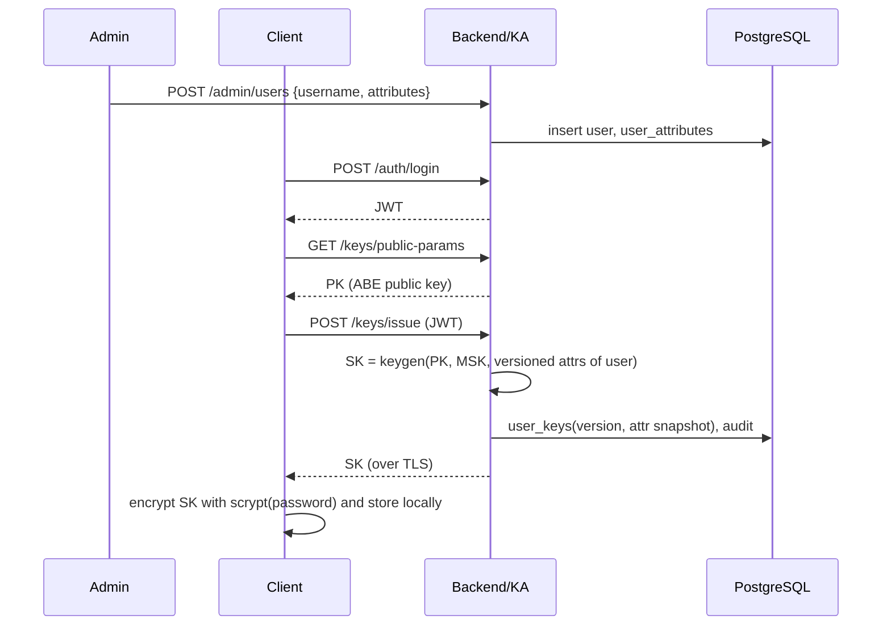
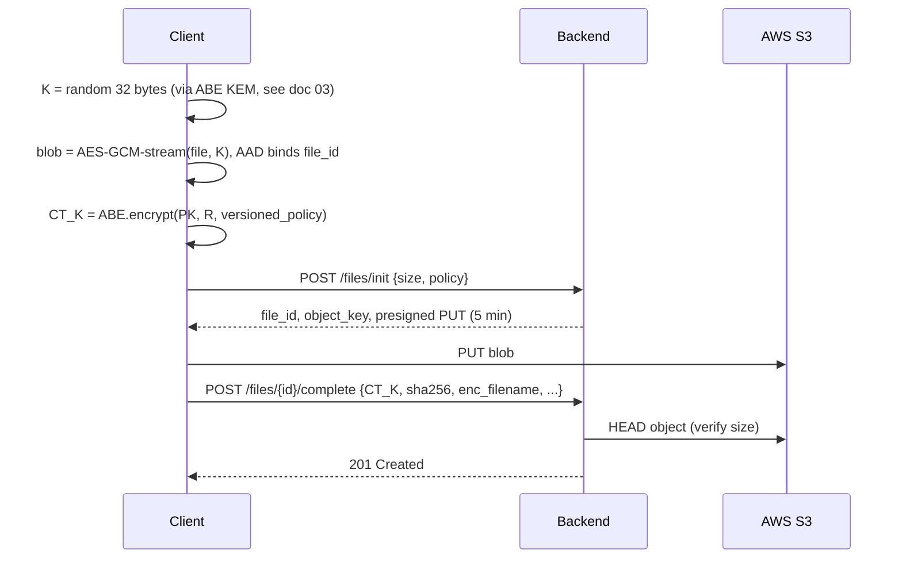
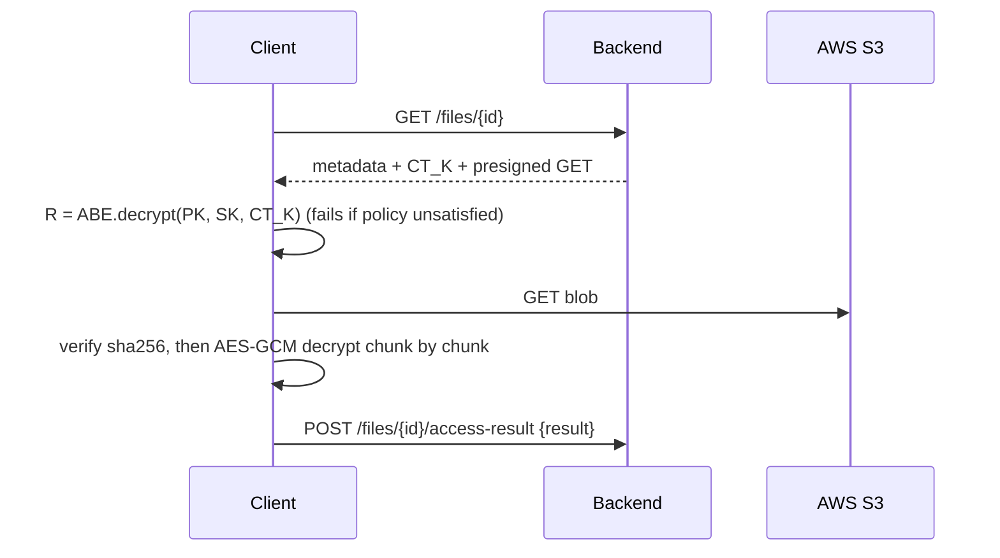
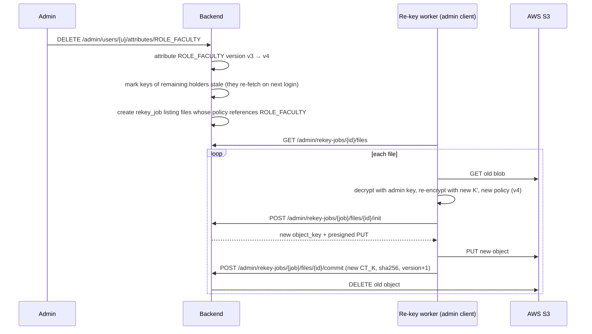

# 02: System Architecture

## 1. High-level view

```
┌───────────────────────────────────────┐
│ CLIENT (user's laptop, trusted)       │
│ Streamlit UI                          │
│ ├─ crypto/aes_stream.py  (AES-GCM)    │
│ ├─ crypto/abe_kem.py     (CP-ABE)     │
│ ├─ crypto/ecc_wrap.py    (X25519)     │
│ └─ keystore/ (scrypt-encrypted SK)    │
└──────┬─────────────────────┬──────────┘
       │ HTTPS + JWT         │ HTTPS (pre-signed URL)
       │ metadata, keys      │ ciphertext bytes only
       ▼                     ▼
┌───────────────────┐   ┌──────────────────────┐
│ BACKEND (FastAPI) │   │ AWS S3 (untrusted)   │
│ auth, key         │──►│ bucket: securevault- │
│ authority,        │   │ <id>, ap-south-1     │
│ metadata API,     │   │ ciphertext objects   │
│ presigner, audit  │   └──────────────────────┘
└──────┬────────────┘
       ▼
┌──────────────────────┐   ┌───────────────────────┐
│ PostgreSQL           │   │ msk.enc (local file)  │
│ users, attributes,   │   │ ABE master secret key │
│ files, wrapped keys, │   │ AES-GCM + scrypt      │
│ audit                │   │ (passphrase in env)   │
└──────────────────────┘   └───────────────────────┘
```

## 2. Components

| Component | Responsibility | Never sees |
|---|---|---|
| **Client** | UI, policy building, all encryption/decryption, local key store | — |
| **Backend API** | Authentication, user/attribute management, ABE key issuance, metadata CRUD, pre-signed URL generation, audit | Plaintext files, file keys |
| **Key Authority module** (inside backend) | `setup()` once → public key (PK) + master secret key (MSK); `keygen(attributes)` per user | File keys, file contents |
| **PostgreSQL** | Metadata, wrapped keys (ABE ciphertexts), audit log | Plaintext, keys in usable form |
| **AWS S3** | Stores encrypted blobs | Everything except ciphertext and sizes |
| **Re-key worker** (admin client mode) | Re-encrypts files after revocation, using an admin ABE key | — (runs on the admin's trusted machine) |

## 3. Trust boundaries
1. **Client ↔ Backend:** The backend is honest-but-curious for data. It authenticates users and issues keys, but it must not be able to read files. A database dump yields only ABE ciphertexts.
2. **Client ↔ S3:** S3 is fully untrusted for confidentiality and integrity. The client verifies GCM tags and the SHA-256 recorded in metadata.
3. **Backend ↔ S3:** The backend holds IAM credentials restricted to one bucket and uses them only to sign URLs and delete objects.

## 4. Data flows

### 4.1 Registration and key issuance


### 4.2 Upload


### 4.3 Download


### 4.4 Revocation


## 5. Deployment view

| Environment | Backend | DB | Storage |
|---|---|---|---|
| Local dev | `uvicorn` in Docker | Postgres in Docker | **moto** (mock S3) or a dev S3 bucket |
| Demo | Docker Compose on laptop | Postgres in Docker | **AWS S3, ap-south-1** |
| Tests | pytest | SQLite or Postgres | moto |

The client runs on the host (or in the `abe-runtime` container with port-mapped Streamlit) and talks to `http://localhost:8000`. For the demo, add HTTPS with a self-signed certificate through uvicorn `--ssl-keyfile/--ssl-certfile`, or explain that TLS terminates at a reverse proxy in production.

## 6. Key design decisions (ADR summary)

| Decision | Chosen | Alternatives | Reason |
|---|---|---|---|
| Where crypto runs | Python client | Browser (React) | No maintained JS/WASM CP-ABE library; client-side encryption is the core security property |
| Bulk cipher | AES-256-GCM, chunked | AES-CBC + HMAC | AEAD gives one primitive for confidentiality and integrity; chunking keeps memory bounded |
| Key protection | CP-ABE (BSW07) KEM | RSA per user | Policy-based sharing without knowing recipients in advance; collusion-resistant |
| Upload path | Pre-signed URLs | Proxy through backend | Backend never touches bytes; clients never hold AWS keys |
| MSK storage | AES-GCM-encrypted file, passphrase in env | AWS KMS | KMS has a monthly per-key cost; the local file keeps the project free |
| Revocation | Versioned attributes + re-encryption | Proxy re-encryption | Much simpler to implement correctly; well understood |
